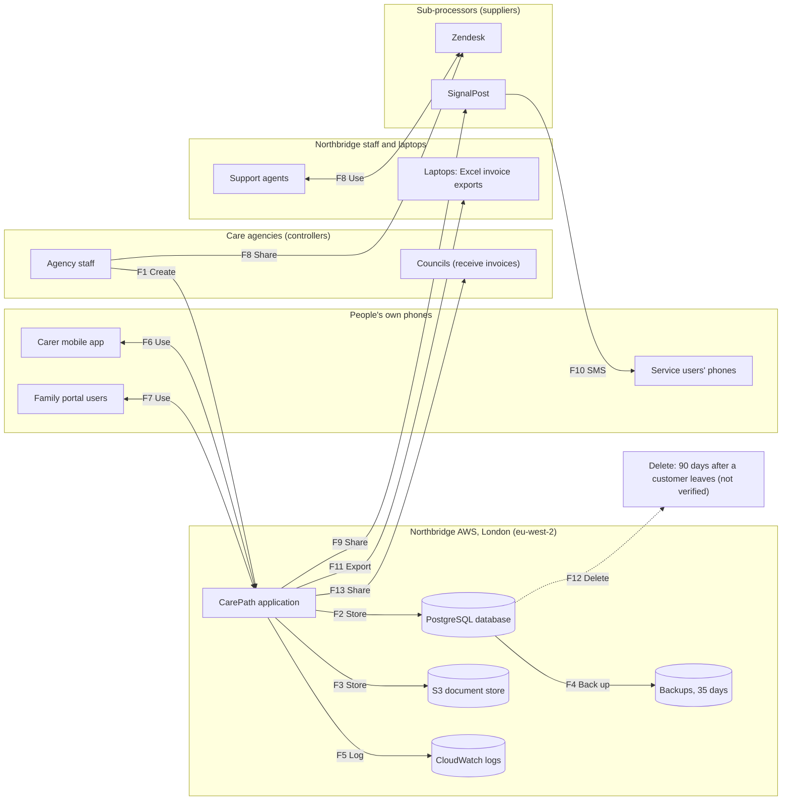

# Data flow: the care record, end to end
Author: Junior GRC Analyst · As of 13 Nov 2026 · Sources: onboarding pack; interviews with Leo, Marcus, Kwame and Grace (GRC-003); [data inventory](data-inventory.csv)

How a service user's care record moves from an agency entering a care plan to its deletion. Each box group is a **trust boundary**: the line where data leaves one organisation's control and enters another's.

## Trust boundaries
1. **Care agencies (controllers):** they decide how their service users' data is used. Northbridge is their processor.
2. **People's own phones:** carers, families and service users. Northbridge doesn't control these devices.
3. **Northbridge AWS, London:** where CarePath runs and stores data.
4. **Northbridge staff and laptops:** data that has left AWS onto company devices.
5. **Sub-processors (suppliers):** Zendesk and SignalPost hold copies of care data under their own control.

## Flows
Encryption labels: **Confirmed** (someone or a document has confirmed it), **Assumed** (likely, with a reason, not confirmed), **Unknown** (no information), **Not encrypted** (known to be unprotected).

| Flow | Stage | From → To | Data (inventory ID) | In transit | At rest | Evidence |
| --- | --- | --- | --- | --- | --- | --- |
| F1 | Create | Agency staff → CarePath | Care records (D-01) | Assumed (web apps normally use HTTPS; not confirmed) | n/a | Pack (Company facts) |
| F2 | Store | CarePath → PostgreSQL database | Care records (D-01); GPS records (D-09); family portal data (D-10) | Unknown (internal AWS network encryption not confirmed) | Unknown (AWS only encrypts a database if it was set up that way) | Leo interview |
| F3 | Store | CarePath → S3 document store | Care-plan PDFs (D-02); DBS scans (D-03) | Unknown (internal AWS network encryption not confirmed) | Assumed (AWS default encryption since Jan 2023; assumption A3) | Leo interview; assumption A3 |
| F4 | Back up | Database → backups (London only) | All database data (D-04) | Unknown (internal AWS backup stream encryption not confirmed) | Unknown (backup encryption not confirmed) | Leo interview |
| F5 | Log | CarePath → CloudWatch logs | Service-user names in logs (D-05) | Unknown (internal AWS log stream encryption not confirmed) | Assumed (AWS states that it always encrypts stored log data) | Leo interview |
| F6 | Use | Carer mobile app ↔ CarePath | GPS check-ins; eMAR updates (D-09) | Assumed (mobile app communicating over HTTPS; not confirmed) | Unknown (app local storage encryption not confirmed) | Pack (Company facts) |
| F7 | Use | Family portal users ↔ CarePath | Family portal accounts and messages (D-10) | Assumed (web apps normally use HTTPS; not confirmed) | n/a | Pack (Company facts) |
| F8 | Share | Agency staff → Zendesk ↔ support agents | Care-plan screenshots (D-06) | Assumed (supplier connections normally use HTTPS) | Unknown (unknown until you've read the supplier's security page) | Marcus interview |
| F9 | Share | CarePath → SignalPost | First name; mobile; visit time (D-07) | Assumed (supplier connections normally use HTTPS) | Unknown (unknown until you've read the supplier's security page) | Marcus interview |
| F10 | Share | SignalPost → service users' phones (SMS) | Reminder texts (D-07) | Not encrypted (text messages aren't protected on their way to the phone) | n/a | Marcus interview |
| F11 | Export | CarePath → staff laptops (Excel) | Invoice reports (D-08) | Assumed (download over HTTPS; not confirmed) | Unknown (the pack mentions Intune, but not disk encryption) | Kwame interview |
| F12 | Delete | Database → deleted 90 days after a customer leaves | All customer data | n/a | n/a | Grace interview: promised in contracts; nobody has checked |
| F13 | Share | CarePath → Councils | Council invoices (D-11) | Assumed (web apps normally use HTTPS; not confirmed) | n/a | Pack (Data held) |

## Flows that worry me
### W1 · Service-user names in application logs (F5, D-05)
Because CarePath writes service-user names into CloudWatch logs, anyone with log access could see who receives care, leading to Restricted data being exposed outside the protections on the main database, and a breach of data minimisation.
- **Evidence:** Leo: "some log lines include service-user names; it's on the backlog."
- **Encryption:** at rest Assumed. That doesn't help, because the problem is who can read the logs.
- **Unknowns:** how long logs are kept; who has access.
- **Candidate risk:** C-07

### W2 · Care-plan screenshots kept in Zendesk (F8, D-06)
Because agencies attach care-plan screenshots to support tickets in Zendesk, Restricted care data is copied into a third-party ticketing platform outside AWS, leading to uncontrolled proliferation of sensitive health records and a breach of data minimisation.
- **Evidence:** Marcus: "support agents ask agencies to attach screenshots to Zendesk tickets."
- **Encryption:** in transit Assumed (HTTPS); at rest Unknown until supplier security review.
- **Unknowns:** how long Zendesk retains ticket attachments; which support staff and supplier personnel can view them.
- **Candidate risk:** C-08

### W3 · Unencrypted reminder texts sent via SignalPost (F9 / F10, D-07)
Because SignalPost transmits visit reminder texts over standard SMS, service-user names, mobile numbers, and visit times are sent unencrypted over cellular networks, leading to interception risks and exposure of Restricted data on recipient mobile devices.
- **Evidence:** Marcus interview; Systems list (SignalPost); visit time and name reveal receipt of care.
- **Encryption:** Not encrypted (text messages aren't protected on their way to the phone).
- **Unknowns:** whether mobile carriers cache SMS message text; who has physical access to recipient phones.
- **Candidate risk:** C-09

### W4 · Invoice reports exported to staff laptops (F11, D-08)
Because Customer Success staff export council invoice reports containing service-user references to Excel on local laptops, Restricted data leaves secure cloud storage onto unverified endpoints, leading to potential data loss or unauthorized local access if laptops are misplaced.
- **Evidence:** Kwame interview ("a few Customer Success staff export invoice reports to Excel on their laptops to reconcile them.").
- **Encryption:** at rest Unknown (Intune device management is present, but full disk encryption status is unconfirmed).
- **Unknowns:** whether local Excel exports are deleted after use; whether staff laptops have confirmed disk encryption.
- **Candidate risk:** C-10

### W5 · Unverified deletion lifecycle for departed customers (F12, D-01)
Because Northbridge relies on unverified contractual promises to delete customer data 90 days after contract termination without technical verification, departed care records may persist indefinitely in the database and backups, leading to retention violations under UK GDPR.
- **Evidence:** Grace interview: "promised in contracts; nobody has checked."
- **Encryption:** n/a (governance and process risk).
- **Unknowns:** whether automated deletion scripts exist; whether backups also purge departed customer records.
- **Candidate risk:** C-11