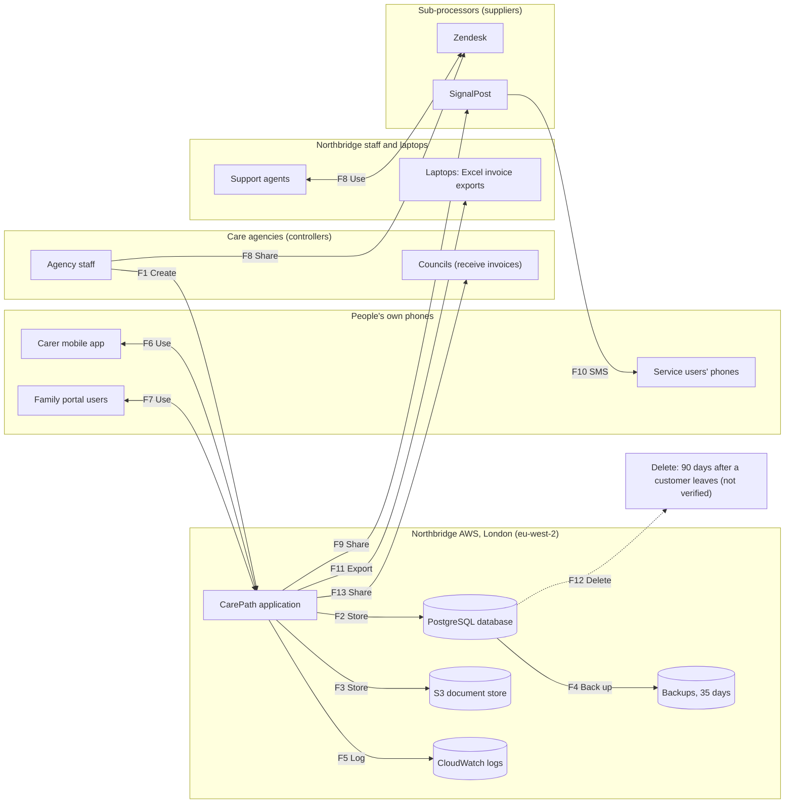

# Data flow: the care record, end to end
Author: Junior GRC Analyst · As of 13 Nov 2026 · Sources: onboarding pack; interviews with Leo, Marcus, Kwame and Grace (GRC-003); [data inventory](data-inventory.csv)

How a service user's care record moves from an agency entering a care plan to its deletion. Each box group is a **trust boundary**: the line where data leaves one organisation's control and enters another's.

## Trust boundaries
1. **Care agencies (controllers):** they decide how their service users' data is used. Northbridge is their processor.
2. **People's own phones:** carers, families and service users. Northbridge doesn't control these devices.
3. **Northbridge AWS, London:** where CarePath runs and stores data.
4. **Northbridge staff and laptops:** data that has left AWS onto company devices.
5. **Sub-processors (suppliers):** Zendesk and SignalPost hold copies of care data under their own control.

## Flows
Encryption labels: **Confirmed** (someone or a document has confirmed it), **Assumed** (likely, with a reason, not confirmed), **Unknown** (no information), **Not encrypted** (known to be unprotected).

| Flow | Stage | From → To | Data (inventory ID) | In transit | At rest | Evidence |
| --- | --- | --- | --- | --- | --- | --- |
| F1 | Create | Agency staff → CarePath | Care records (D-01) | Assumed (web apps normally use HTTPS; not confirmed) | n/a | Pack (Company facts) |
| F2 | Store | CarePath → PostgreSQL database | Care records (D-01); GPS records (D-09); family portal data (D-10) | Unknown (internal AWS network encryption not confirmed) | Unknown (AWS only encrypts a database if it was set up that way) | Leo interview |
| F3 | Store | CarePath → S3 document store | Care-plan PDFs (D-02); DBS scans (D-03) | Unknown (internal AWS network encryption not confirmed) | Assumed (AWS default encryption since Jan 2023; assumption A3) | Leo interview; assumption A3 |
| F4 | Back up | Database → backups (London only) | All database data (D-04) | Unknown (internal AWS backup stream encryption not confirmed) | Unknown (backup encryption not confirmed) | Leo interview |
| F5 | Log | CarePath → CloudWatch logs | Service-user names in logs (D-05) | Unknown (internal AWS log stream encryption not confirmed) | Assumed (AWS states that it always encrypts stored log data) | Leo interview |
| F6 | Use | Carer mobile app ↔ CarePath | GPS check-ins; eMAR updates (D-09) | Assumed (mobile app communicating over HTTPS; not confirmed) | Unknown (app local storage encryption not confirmed) | Pack (Company facts) |
| F7 | Use | Family portal users ↔ CarePath | Family portal accounts and messages (D-10) | Assumed (web apps normally use HTTPS; not confirmed) | n/a | Pack (Company facts) |
| F8 | Share | Agency staff → Zendesk ↔ support agents | Care-plan screenshots (D-06) | Assumed (supplier connections normally use HTTPS) | Unknown (unknown until you've read the supplier's security page) | Marcus interview |
| F9 | Share | CarePath → SignalPost | First name; mobile; visit time (D-07) | Assumed (supplier connections normally use HTTPS) | Unknown (unknown until you've read the supplier's security page) | Marcus interview |
| F10 | Share | SignalPost → service users' phones (SMS) | Reminder texts (D-07) | Not encrypted (text messages aren't protected on their way to the phone) | n/a | Marcus interview |
| F11 | Export | CarePath → staff laptops (Excel) | Invoice reports (D-08) | Assumed (download over HTTPS; not confirmed) | Unknown (the pack mentions Intune, but not disk encryption) | Kwame interview |
| F12 | Delete | Database → deleted 90 days after a customer leaves | All customer data | n/a | n/a | Grace interview: promised in contracts; nobody has checked |
| F13 | Share | CarePath → Councils | Council invoices (D-11) | Assumed (web apps normally use HTTPS; not confirmed) | n/a | Pack (Data held) |

## Flows that worry me
TO-FILL in Step 4.
